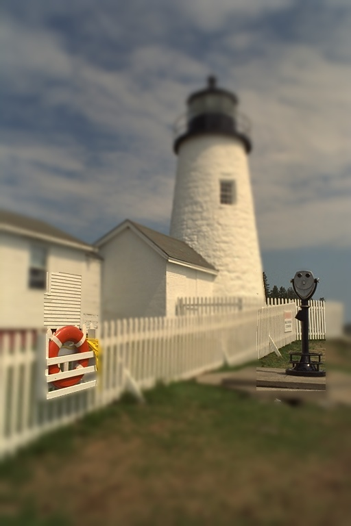
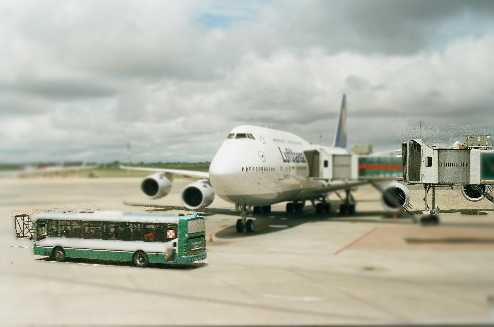

# 景深效果與動態短片應用

以 Python、PyQt5 與 OpenCV 製作的影像處理課程專案。從照片選取主體，保留前景清晰、模糊背景，並利用前後景不同位移產生動態短片。

本專案整理自 **ADIPHW Project 3 goodwork**，是本次盤點找到最新可讀的完整整合應用。Project 4 的原始碼檔案內容異常，尚未找回，沒有將此整理版稱為 Project 4。原始程式保留於 [archive](archive/Depth_of_field_project3.py)，版本來源與調整記錄見 [整理紀錄](docs/PROVENANCE.md)。

## 示範

| 單物件：燈塔 | 多物件：機場場景 |
| --- | --- |
|  |  |

[範例檔案與來源](examples/README.md)包含兩組原圖、歷史自動／多框處理結果及 MP4。下載專案後，以瀏覽器開啟 [互動範例頁](examples/index.html)，可比較原圖與結果並播放短片。這些是作業留下的歷史輸出，未聲稱由整理版逐像素重現。

## 使用 Windows 應用程式

從本儲存庫 **Releases** 下載 Windows x64 ZIP，解壓後執行 `DepthOfField.exe`，無須另外安裝 Python。此為本次依整理版來源重新建置的應用程式；舊作業 EXE 未混入 Git 紀錄。

1. 按「選擇圖像」載入 JPG、PNG 等照片。
2. 「開始處理一」使用圖像中央區域初始化主體分割。或按「選取多物件」，拖曳框選一或多個區域，再按「開始處理二」。
3. 調整模糊強度後，重新按相應處理按鈕套用。
4. 按「顯示結果」預覽；該視窗按任意鍵可關閉。按「保存結果」另存圖片。
5. 完成景深處理後，設定影片秒數與 FPS，按「生成動圖」儲存 **MP4 影片**。

先使用小圖測試；高解析度照片與較強模糊設定會建立多張模糊圖層，可能需要較長時間與較多記憶體。

## 從原始碼執行

本次驗證環境為 Windows x64、Python 3.12.15。請在專案目錄執行：

```powershell
py -3.12 -m venv .venv
.\.venv\Scripts\python.exe -m pip install -r requirements.txt
.\.venv\Scripts\python.exe Depth_of_field.py
```

若沒有 `py` 指令，可改用本機 Python 3.12 的完整路徑建立虛擬環境。依賴固定為本次測試使用的版本。未驗證 macOS、Linux 或其他 Python 版本。

## 建置與測試

```powershell
.\.venv\Scripts\python.exe -m unittest discover -s tests -v
$buildVenv = Join-Path $env:TEMP 'adip-depth-build'
py -3.12 -m venv $buildVenv
& (Join-Path $buildVenv 'Scripts\python.exe') -m pip install -r requirements-build.txt
& (Join-Path $buildVenv 'Scripts\python.exe') -m PyInstaller --noconfirm DepthOfField.spec
```

建置結果為 `dist/DepthOfField.exe`。`build/`、`dist/`、虛擬環境及暫存輸出不納入版本控制；可下載應用程式放在 Release 附件。

建置環境請放在純英數路徑；若 Windows 使用者名稱含中文，請將 `$buildVenv` 指定到另一個可寫的英數路徑。PyQt5 在部分中文環境路徑會回報錯誤的外掛位置，造成 `no Qt platform plugin could be initialized`。整理版已在啟動時明確指定套件內的外掛位置，且另外驗證中文專案路徑下的啟動；這項修正不會修改系統 Qt 設定。

## 方法與限制

- 主體選取：CLAHE 對比增強、GrabCut 分割及 FloodFill 遮罩處理。
- 景深模擬：依遮罩保留前景，背景依距離圖選擇不同高斯模糊圖層；使用執行緒池產生圖層。
- 動態短片：對前景與背景套用不同振幅及頻率的正弦位移，再合成輸出。
- 此方法不使用深度估測模型，也不重建三維場景；複雜邊界、背景及遮擋可能產生分割或位移接縫。
- 本次僅收錄與此應用相關的精選素材；未上傳成績、同學資料、報告、整份課程資料集或異常原始碼。

## 權利說明

原圖與歷史結果的資料夾未附來源或授權文件，因此目前保留課程成果與來源記錄，未自行宣告程式或素材為 MIT 等開源授權；若要再散布或商用，需另確認相應權利。
